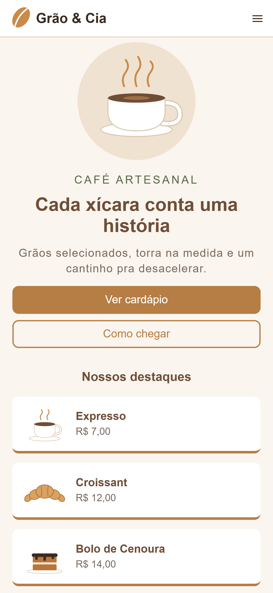
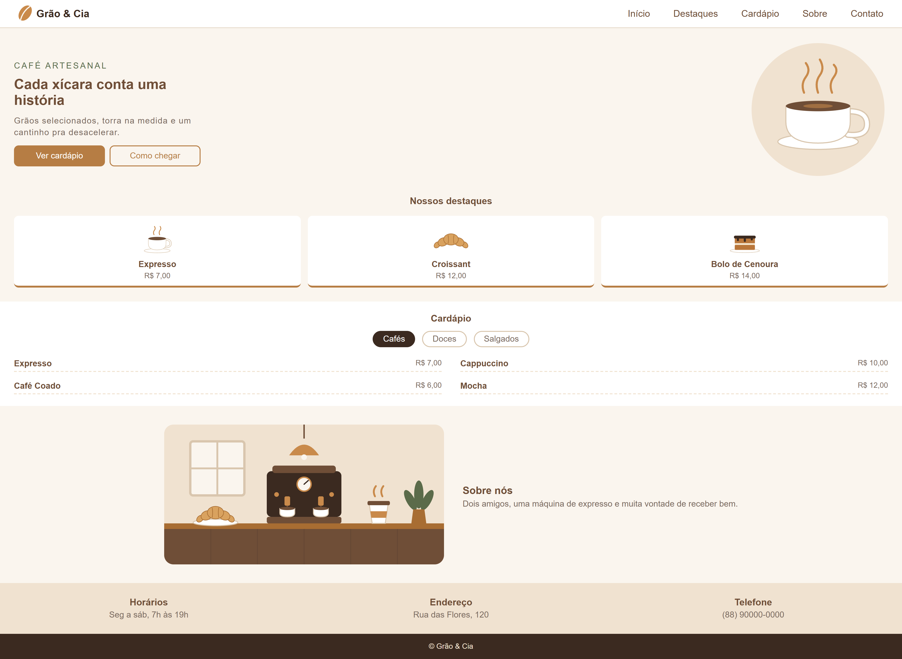

# Grão & Cia | Landing page de cafeteria

Landing page responsiva de uma cafeteria fictícia, feita com **HTML, CSS e JavaScript puros**, sem frameworks. É um projeto de estudo: a marca, os textos e os preços são inventados.

## Demonstração

- **Página publicada:** [COLE AQUI O LINK DO GITHUB PAGES]
- **Capturas de tela:**

| Celular | Computador |
|---|---|
|  |  |

## Seções

- **Início:** apresentação da cafeteria, com dois botões de ação.
- **Destaques:** três produtos em cartões.
- **Cardápio:** itens divididos em três categorias (Cafés, Doces e Salgados), com filtro.
- **Sobre nós e contato:** texto de apresentação, horário de funcionamento, endereço e telefone.

## Funcionalidades

- **Layout responsivo (mobile-first):** a página começa pensada para o celular e se reorganiza a partir de 820px de largura, com seções em colunas e cartões lado a lado.
- **Menu em duas versões:** no celular, um botão abre um painel que sobe sobre a página, bloqueia a rolagem e troca o ícone por um X. No computador, os links aparecem direto no cabeçalho.
- **O menu fecha de vários jeitos:** pelo botão, ao clicar num link, ao apertar `Esc` e quando a janela é alargada até o layout de computador.
- **Filtro do cardápio:** os botões de categoria mostram só os itens escolhidos. O JavaScript lê o `data-menu` de cada botão e o relaciona ao bloco do cardápio de mesmo nome.
- **Rolagem suave** até as seções, com respeito à preferência de movimento reduzido do sistema. A margem de rolagem compensa a altura do cabeçalho fixo.
- **Imagens fluidas:** as ilustrações em SVG se ajustam à largura disponível sem distorcer.

## Acessibilidade

- O botão do menu é um `button`, com nome acessível (`aria-label`) e estado (`aria-expanded`), e os botões do filtro informam qual categoria está ativa (`aria-pressed`).
- Os links do menu fechado ficam fora da navegação por teclado (`visibility: hidden`).
- O foco do teclado tem contorno visível (`:focus-visible`), com contraste conferido.
- Imagens decorativas têm `alt` vazio.

## Tecnologias

- **HTML5:** estrutura semântica (`header`, `nav`, `main`, `section`, `footer`).
- **CSS3:** variáveis, Flexbox, Grid, media queries, `position` (fixed e sticky), `calc()` com `dvh`, transições e `transform`.
- **JavaScript:** manipulação do DOM, eventos, `classList`, `dataset`, `setAttribute` e `matchMedia`.

## Estrutura do projeto

```
cafeteria/
├── index.html
├── style.css
├── script.js
├── img/          ilustrações e ícones em SVG
└── screenshots/  capturas de tela usadas neste README
```

## Como executar

1. Clone o repositório:
   ```
   git clone https://github.com/LeviAlencar-dev/preojeto-cafeteria.git
   ```
2. Abra o arquivo `index.html` no navegador. Não há dependências nem etapa de instalação.

## O que pratiquei neste projeto

- Construir um menu que muda de comportamento conforme a largura da tela, e fazer o JavaScript acompanhar essa mudança com `matchMedia`.
- Usar `transform`, `opacity` e `visibility` juntos para animar um painel sem deixá-lo acessível por teclado quando está fechado.
- Entender especificidade e ordem das regras no CSS, e como elas afetam media queries.
- Filtrar conteúdo com JavaScript usando atributos `data-*`, e manter o estado acessível com `aria-pressed`.
- Compensar um cabeçalho fixo nas âncoras com `scroll-margin-top`.
- Escrever o CSS mobile-first, com variáveis para a paleta.
- Organizar as propriedades de cada regra numa ordem consistente.

## Autor

**Levi Alencar**, estudante de Ciência da Computação em formação Full Stack.

- LinkedIn: [linkedin.com/in/levi-alencar-4b5063429](https://www.linkedin.com/in/levi-alencar-4b5063429)
- GitHub: [github.com/LeviAlencar-dev](https://github.com/LeviAlencar-dev)
